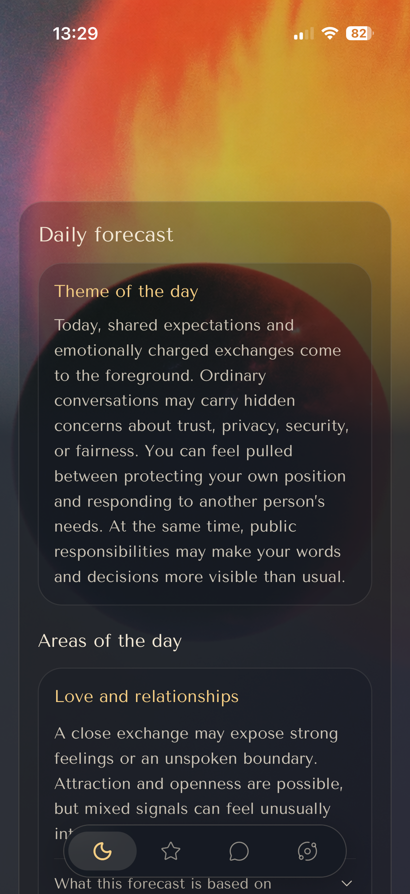
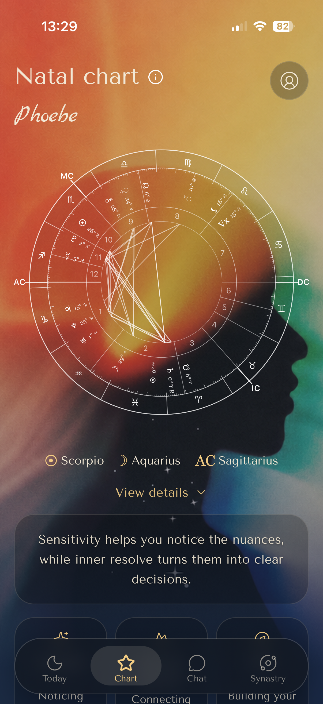
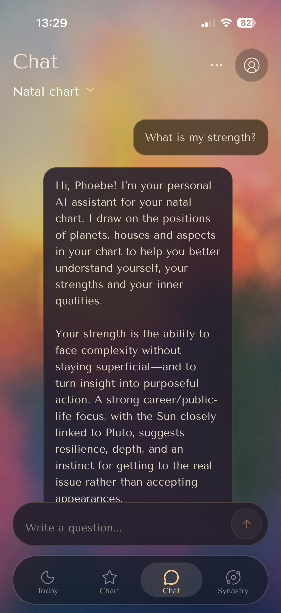
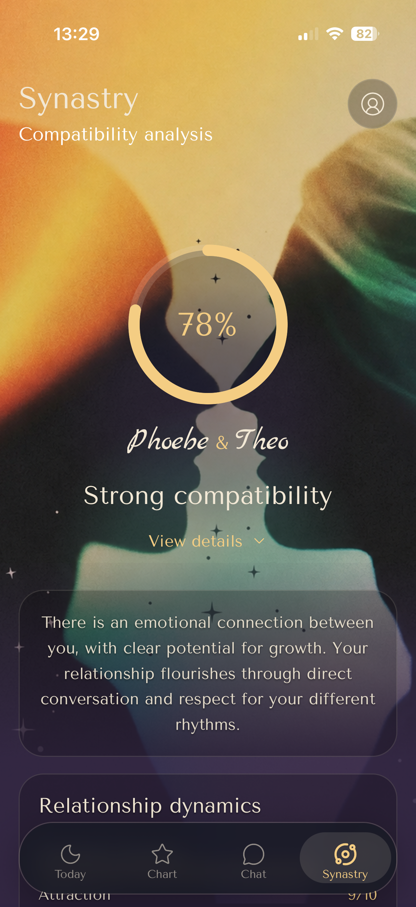

# Stiddi

**Product and AI Case Study**

A Telegram Mini App combining astronomical calculations, personalized astrology readings, and contextual AI conversations.

**Current status: Stiddi is live as a Telegram Mini App. [Open Stiddi in Telegram](https://stiddi.app/start).**

This is a documentation-only portfolio repository. The application source code remains private.

## Product Overview

Stiddi brings natal charts, forecasts, relationship readings, and AI conversations into one experience in **English, French, and Russian**.

The product goal was to make complex chart information easier to explore through clear navigation, personalized explanations, and conversations connected to the user's own readings.

The project covers product definition, visual design, AI integration, monetization, quality assurance, and launching a Telegram Mini App. Astrological interpretations are designed for reflection and entertainment, not as medical, legal, or financial advice.

  
  
  
  

*Daily forecast, natal chart, contextual AI chat, and synastry in the English-language demo profile.*

## My Role

I created and launched Stiddi as a Telegram Mini App, from the initial concept through design, development, testing, and release.

I defined the concept, features, user journeys, and visual design. I created the illustrations in Ideogram from my own prompts and worked on the presentation of charts, readings, onboarding, and purchase screens.

I designed and refined the AI prompts, evaluated responses across three languages, and worked on personalization, clarity, and consistency.

I managed development using **Codex as an AI coding assistant**. I prioritized changes, defined acceptance criteria, tested the application, identified issues, reviewed fixes, and made product decisions throughout the project. This included preparing the Telegram launch, checking purchase journeys, and documenting the product.

## Main Features

- **Natal charts:** planetary positions, houses, aspects, and chart visualization.
- **Personal readings:** personality analysis and four life areas.
- **Forecasts:** daily, weekly, monthly, and annual readings.
- **Relationship readings:** romantic compatibility through comparison of two natal charts, also known as synastry.
- **Additional charts:** child charts and adult charts for other people.
- **Contextual AI chat:** questions about a specific chart, forecast, or relationship reading.
- **Saved content:** charts and readings that users can revisit across sessions.
- **Accounts and purchases:** Telegram authentication, monthly and yearly Premium access, and separate content purchases through Telegram Stars.

## System Architecture

Stiddi connects a Telegram Mini App built with React Native, React Native Web, Expo, and TypeScript to a Python backend. Calculations, AI integration, accounts, and application data are handled on the server.

| Layer | Responsibility |
| --- | --- |
| Telegram Mini App | Navigation, chart visualization, readings, chat, and purchase screens inside Telegram |
| Backend API | Accounts, access management, calculation requests, and saved content |
| Calculation engine | Astronomical positions and chart-specific calculations |
| AI integration | Personalized interpretations and contextual answers |
| Database | Application accounts, charts, readings, and purchase-related data |
| Telegram integration | Mini App launch, server-side validation of Telegram initData, and Telegram Stars payment confirmation |

**Astronomical calculations:** Stiddi uses a custom calculation engine built around established libraries, including Skyfield, and NASA/JPL astronomical data. The backend calculates positions and prepares chart information before the AI interpretation stage.

**Infrastructure:** The application backend is hosted on **Hetzner Cloud in Germany**.

A typical reading starts with the user's chart inputs, continues through backend calculations and AI interpretation, and is saved for later access in the application.

## Technology Stack

| Area | Technologies |
| --- | --- |
| Frontend | React Native, React Native Web, Expo, TypeScript |
| Telegram | Telegram Mini Apps, Telegram Stars |
| Backend | Python, FastAPI, SQLite |
| AI | OpenAI API, prompt engineering |
| Astronomy | Skyfield, NASA/JPL data |
| Infrastructure | Hetzner Cloud |
| Testing and Release | GitHub Actions, automated backend and frontend checks, Telegram web releases |
| Development Assistance | Codex |
| Visual Assets | Ideogram |

## AI Integration & Testing

The AI layer turns calculated chart information into readable interpretations in the selected language. Contextual conversations use the relevant chart, forecast, or saved reading.

A key architectural decision was to **separate astronomical calculations from AI interpretation**: the calculation engine supplies the data, while the model explains that material. Model requests are handled by the backend.

My work on AI quality included refining task-specific prompts, reviewing tone and structure, checking personalization, and investigating inconsistent or unsuitable responses across English, French, and Russian.

Testing combined automated backend and frontend checks with browser testing and owner-performed checks in Telegram. The main user journeys reviewed included:

- Sign-in, onboarding, navigation, and account switching.
- Telegram Stars purchases, subscription access, cancellation, refunds, and returning to the correct content after payment.
- First chat entry, question balances, and access to purchased content.
- Reading presentation, localization, and error states.

**Security and reliability:** server-side validation of Telegram authentication data, payment verification, error handling, data protection, and automated testing.

One important lesson was to test complete journeys rather than isolated screens. A successful payment, for example, also needs to result in the correct content access and chat experience. Localization similarly involves presentation and behavior, not just translated text.

## Links & Contact

- [Open Stiddi in Telegram](https://stiddi.app/start)
- [Stiddi website](https://stiddi.app/)
- [Support](https://stiddi.app/support/)
- [Privacy policy](https://stiddi.app/privacy/)
- **Contact:** contact@stiddi.app

This case study covers the design, development, testing, and launch of the live Telegram Mini App. Ongoing work includes product improvements, quality assurance, and operational monitoring.

Stiddi's application code and brand assets remain proprietary. Third-party libraries, assets, and datasets retain their respective licenses and attribution requirements.
